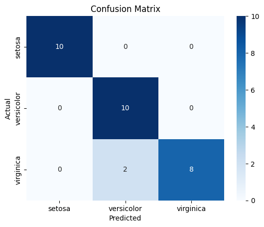

# Iris Flower Classification

A supervised learning pipeline that classifies iris flowers into three species using K-Nearest Neighbors.

## Dataset

The Iris dataset has 150 samples, 3 balanced classes (setosa, versicolor, virginica) and 4 features: sepal length, sepal width, petal length and petal width.

## Pipeline

1. Load and inspect the data
2. Split into 80% training and 20% testing (shuffled and stratified)
3. Scale features with StandardScaler, fitted on the training set only
4. Train a KNN classifier
5. Choose K with 5-fold cross-validation
6. Evaluate with a confusion matrix, precision, recall and F1 score

## Project Structure

```
iris-classifier/
├── data/
├── images/
├── notebooks/
├── src/
│   ├── explore.py
│   ├── preprocess.py
│   ├── model.py
│   ├── tune.py
│   └── evaluate.py
├── requirements.txt
└── README.md
```

## How to Run

```
pip install -r requirements.txt
python src/explore.py
python src/tune.py
python src/evaluate.py
```

## Results

Best K from cross-validation: 5. Test accuracy: 93.3% (28 of 30 correct).

| Species | Precision | Recall | F1 |
|---|---|---|---|
| setosa | 1.00 | 1.00 | 1.00 |
| versicolor | 0.83 | 1.00 | 0.91 |
| virginica | 1.00 | 0.80 | 0.89 |



Setosa is classified perfectly. The only errors are two virginica flowers predicted as versicolor, which are the two most similar species.
